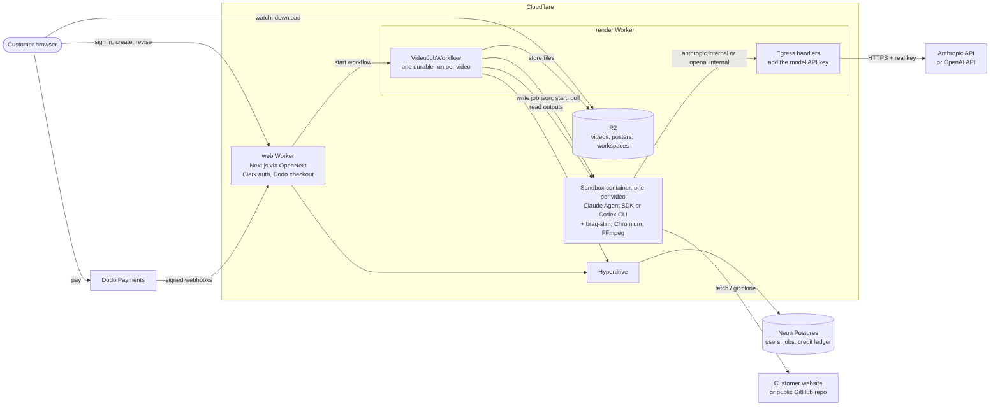
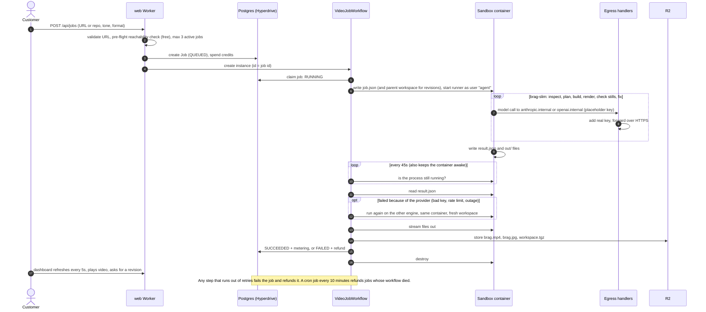
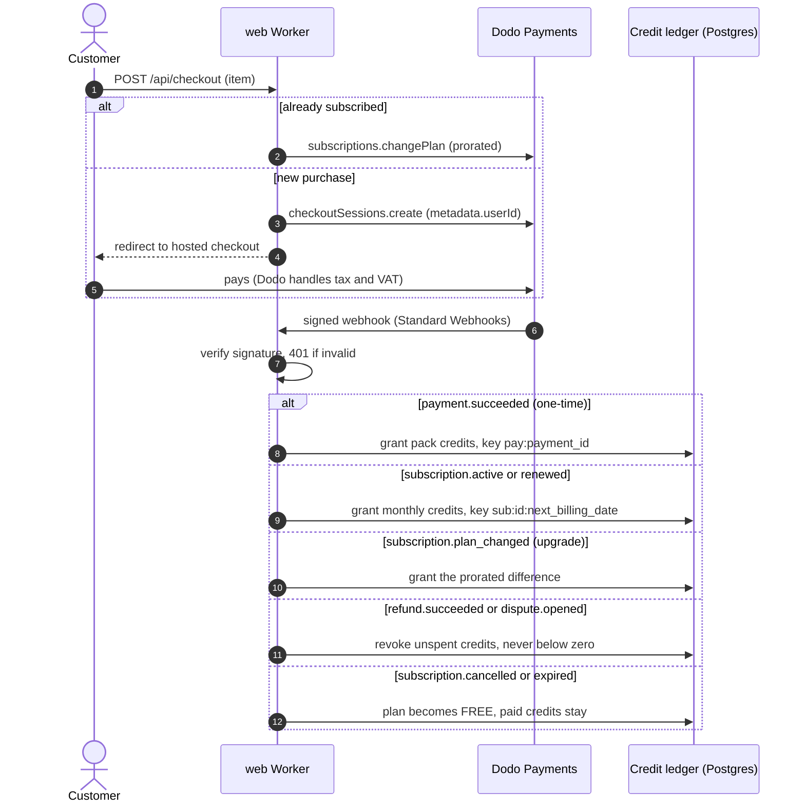
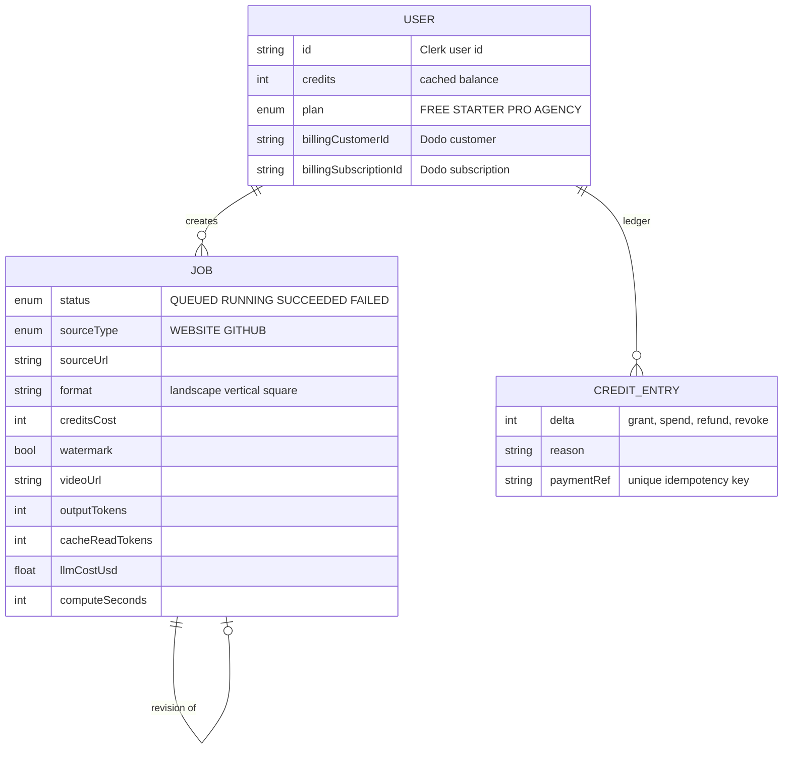

# Architecture

This covers four things:
1. How a website or repo becomes a launch video.
2. How payments become credits.
3. How the system stays safe with untrusted input.
4. How it stays cheap and profitable as it scales.

Everything runs on Cloudflare except the Postgres database (Neon, reached through Hyperdrive) and the outside services: Clerk, Dodo Payments and the model providers (Anthropic by default, OpenAI as an option and automatic fallback). The diagrams are Mermaid, so they render on GitHub.

**Status markers:**
- ✅ built in this repo and checked in Cloudflare's local runtime
- 🧪 built, needs a live test on Cloudflare
- 🔜 planned (step numbers refer to [PLAN.md](PLAN.md))

## Principles

1. **One video is one agent session, on either of two engines.** brag is an agent skill, not a library. Each job runs the unmodified `/brag-slim` skill: inspect → plan → build → render → check → deliver. The engine is Claude (through the Claude Agent SDK) or OpenAI (through the Codex CLI); both read the same skill file. If the primary provider fails (bad key, rate limit, outage), the job is retried once on the other.
2. **Untrusted input runs in a throwaway container that holds nothing worth stealing.** Customer websites and repos can contain prompt injection. The container has no API key, no database access and no storage credentials.
3. **The credit ledger is the source of truth for money.** Every grant, spend, refund and clawback is a ledger row with a unique idempotency key. Webhooks and workflow steps can retry safely.
4. **Meter every job, and keep the cost per video low.** Tokens, cache use, dollars and minutes are recorded for each video, and `/dashboard/admin` turns them into margins. Free videos use the cheaper model.
5. **Managed building blocks.** Workers, Workflows, Containers, R2 and Hyperdrive. No servers to patch and no queue to run.

## System overview

## Components

| Component | Responsibility | Tech | Status |
|---|---|---|---|
| web Worker (`web/`) | Landing page, dashboard, admin. Job creation with a pre-flight check, revisions, checkout, billing portal, Dodo webhooks | Next.js 15 on Workers via OpenNext, Clerk | ✅ builds, boots and serves in workerd |
| Database | Users, jobs, credit ledger, metering | Neon Postgres, via Hyperdrive, using Prisma with the `pg` driver adapter and one client per request | ✅ adapter verified; 🧪 against a live Neon database |
| render Worker (`render/`) | `VideoJobWorkflow` (claim → pick engines → start → poll → collect → second engine if the provider failed → finish or refund → destroy), cron safety net | Workers + Workflows | ✅ bundles and boots; 🧪 end to end |
| `VideoSandbox` | One container per video. Egress handlers for `anthropic.internal` and `openai.internal` | Cloudflare Sandbox SDK 0.12.10 (Containers), `standard-4` = 4 vCPU / 12 GiB / 20 GB | 🧪 image needs Docker to build |
| Runner (`runner/`) | Inside the container: prepares the workspace, runs brag-slim on the chosen engine, watermarks free videos, writes `result.json` | Node 22, Claude Agent SDK, Codex CLI, Playwright Chromium, FFmpeg | ✅ bundles; 🧪 in a container |
| Object storage | `brag.mp4`, `brag.jpg`, `workspace.tgz` for revisions | R2 bindings (no egress fees) with a public custom domain | 🧪 |
| Payments | Hosted checkout, subscriptions, customer portal, tax as merchant of record | Dodo Payments | ✅ signature checks tested |
| Email | "Your video is ready", onboarding | Cloudflare Email Service | 🔜 Step 3 |
| GitHub App | Release → draft video → approve → post | Webhooks into the web Worker | 🔜 Step 8 |

## Video job lifecycle

**Revisions** restore the parent's `workspace.tgz` (plan and composition) into the new container. The agent edits the existing video instead of starting over, at roughly 40% of the cost of a new one.

**Cost controls built into the pipeline:**
- The pre-flight check rejects unreachable sites and private or missing repos before any tokens are spent.
- Free videos run on each provider's cheaper model and are capped at 15 seconds.
- Each attempt has a turn limit and a ~45-minute limit (in the workflow). On Claude the SDK also enforces a dollar ceiling, and a fallback attempt only gets what the first attempt left of it. Codex has no dollar ceiling, which is why the OpenAI engine defaults to `gpt-6-sol`, priced like Sonnet 5.
- An orphaned container sleeps after 15 idle minutes, so it can't run up a bill.

## Payments and credits

We keep our own ledger instead of Dodo's built-in credit entitlements for three reasons:
- Spending credits and creating a job happen together.
- Refunds for failed renders are instant.
- The payment provider stays swappable. Only `web/lib/dodo.ts` and three routes know about Dodo.

## Data model

The job contract between the Worker and the container (`JobSpec` → `job.json`, `JobResult` ← `result.json`) lives in `packages/core/src/contract.ts`.

🔜 Planned entities:
- `Workspace`, `Member`, `BrandKit`, `GithubInstallation` and `ApiKey` (Step 8)
- `ShareView` (Step 3)

## Security and trust zones

| Zone | Runs | Holds | Trusts |
|---|---|---|---|
| Browser | The customer | A Clerk session | Nothing |
| web Worker | Dashboard, API, webhooks | Clerk and Dodo secrets, a Hyperdrive binding | Clerk sessions, signed webhooks |
| render Worker | Workflow, egress handlers, cron | The Anthropic and OpenAI keys and the private-repo token key (secrets), Hyperdrive and R2 bindings | The web Worker's workflow binding |
| Sandbox container | One agent session | A job spec and a placeholder API key; **nothing reusable** | Nothing. Treated as hostile |

The key design choice: the agent in the container is pointed at virtual hosts. Claude Code uses `http://anthropic.internal` (`ANTHROPIC_BASE_URL`) and Codex uses `http://openai.internal/v1` (a custom model provider). Cloudflare routes those hosts to the render Worker's `outboundByHost` handlers, which add the real key and forward over HTTPS. Because only these two hosts are intercepted, the agent's browsing of the customer's site is untouched: no certificate tricks, and no key to exfiltrate.

**Controls**
- **Container:**
  - The agent runs as user `agent`, not root.
  - The container is destroyed after the job.
  - It sleeps after 15 idle minutes if orphaned.
- **Private repos:** the customer's GitHub token is encrypted in their browser (ECDH P-256 + AES-256-GCM, bound to their user id) and stored only as ciphertext. The render Worker alone holds the private key, as a secret. It decrypts the token for one download from GitHub, streams the code into the container as files, and drops it. The token never enters the container, a step result or a log. Limit: anyone who can deploy code could change it to capture tokens, so deploys go through reviewed CI.
- **Workspace:** cloned repos lose `.claude/`, `.agents/`, `.codex/`, `.opencode/`, `CLAUDE.md`, `AGENTS.md` and `.mcp.json`, so a repo can't configure either agent. The prompt tells the agent to treat site and repo text as content, never as instructions.
- **Cost:**
  - turn limit and workflow time limit on both engines, plus the SDK dollar ceiling on Claude
  - free-tier model and length caps
  - provider spend limits: an Anthropic workspace limit and an OpenAI project budget
- **Web Worker:**
  - Clerk on every non-public route; admin behind an allow-list
  - webhook signatures verified
  - URL validation (`global_fetch_strictly_public` also blocks private addresses)
  - pre-flight check
  - at most 3 active jobs per user
- **Content:** an ownership checkbox, enforced by the API. Brand and adult-site block lists (🔜 Step 3), as Dodo's policy for AI content tools requires.

## Deployment and environments

| | Local | Production |
|---|---|---|
| Web | `next dev` (bindings emulated from `web/wrangler.jsonc`), or `opennextjs-cloudflare preview` | web Worker (`npm run deploy:web`) |
| Render | `wrangler dev` in `render/` (Docker required for the container) | render Worker + Containers (`npm run deploy:render`) |
| Database | Docker Postgres (`docker compose up -d`) | Neon via Hyperdrive |
| Payments | Dodo test mode | Dodo live mode after approval |
| Storage | Local R2 simulation in wrangler dev | R2 bucket with a custom domain |
| Demo | `npm run demo` (sample data, no services) | Never available |

**Deploy notes:**
- Deploy `render` before `web`, because the web Worker binds to the render Worker's workflow.
- A deploy replaces running containers. `rollout_active_grace_period` gives in-flight renders 40 minutes.
- Run `prisma db push`, and later `prisma migrate deploy`, from a machine with the direct Neon URL, not through Hyperdrive (Hyperdrive doesn't support the advisory locks Prisma Migrate uses).
- Hyperdrive is created with query caching **disabled**. Its default 60-second read cache isn't cleared on writes, which would serve stale credit balances and job status.
- Deploy from CI (Workers Builds or GitHub Actions). The OpenNext build compiles local `.env` files into the web Worker bundle.

## Capacity and scaling

- A video takes 10–20 minutes, so **one container makes about 4 videos an hour**.
- `max_instances` (20 to start) caps how many render at once. The account limit is far higher: 1,500 concurrent vCPU.
- **Model provider rate limits are the real ceiling.** Twenty renders at once is roughly 100+ requests and ~120k output tokens per minute. Request an increase at least 2 weeks before launch, and match `max_instances` to it. The OpenAI fallback adds headroom when Anthropic returns 429s or has an outage.
- **Compute cost:** about $0.00011 per second on `standard-4`, so about $0.10 for a 15-minute render. That's small next to about $2–5 of model tokens.
- **Workflows:** up to 10,000 steps per instance (a job uses about 70, or about 140 when it falls back to the second engine) and tens of thousands of concurrent instances.

## Observability and cost control

- **Per job (✅, `Job` table):** model, turns, input/output/cache tokens, dollars, render minutes, attempts. After a fallback, the job shows the second engine's model and the cost of both attempts added together.
- **`/dashboard/admin` (✅):** cost per delivered video (failures included), p90 cost, failure rate, margin per plan.
- **Cloudflare observability** is enabled on both Workers: logs and traces for every request and workflow step.
- **Alerts (🔜):** p90 cost over $8, failure rate over 15%, renders waiting longer than 20 minutes, webhook failures, provider 429s, how often jobs fall back to the second engine.

## Failure modes

| Failure | What happens |
|---|---|
| Site unreachable or repo private | Rejected up front by the pre-flight check. No credits spent, no tokens used |
| Agent fails, or hits the cost, turn or time limit | Job FAILED, credits refunded, error shown to the customer |
| Container restarted by Cloudflare mid-job | The process disappears, so the workflow finds no result and fails the job with a refund. Retrying once automatically is 🔜 |
| Workflow step throws | Retried with backoff. After the last retry: fail and refund |
| Workflow dies entirely | The cron job every 10 minutes refunds jobs stuck RUNNING over 120 minutes (room for two engine attempts) or QUEUED over 30, and destroys their containers |
| Deploy during renders | In-flight containers get up to 40 minutes to finish |
| Dodo webhook duplicated or out of order | Idempotent ledger keys; plan state comes from each event's subscription object |
| Provider outage, rate limit or bad key | The agent's own client retries first: Claude gets 6 retries (about 40 seconds) when a fallback is waiting, or its full ~3 minutes on the last engine. If the job still fails for a provider reason, it runs once more on the other engine in the same container. Only then is it refunded. Pause the free tier first |

## Evolution

1. **Now:** everything above is built. Next is a live end-to-end test on Cloudflare (PLAN Step 1 and Step 4).
2. **Step 3:** emails (Cloudflare Email Service), share pages, block lists, analytics.
3. **Step 8:**
   - a GitHub App, where release webhooks create jobs
   - brand kits fed into the prompt
   - agency workspaces
   - a public API
4. **Cost-down work (continuous):**
   - scene templates to cut output tokens
   - a pre-extracted site brief to cut exploratory turns
   - an automatic retry after a container restart
